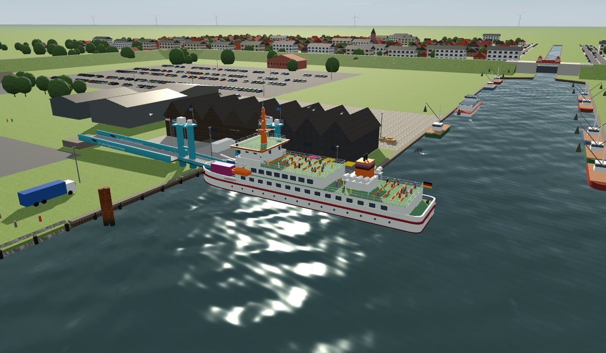

# Inselfähre Langeoog

3D-Fährsimulation für Handy und Browser: Als Kapitän der MS Langeoog IV legen Sie in Bensersiel ab, fahren durch das Außentief und das Wattenmeer und machen rechtzeitig im Inselhafen Langeoog fest, damit die Fahrgäste die Inselbahn erreichen.

**Jetzt spielen:** `https://<IHR-BENUTZERNAME>.github.io/inselfaehre-langeoog/`

## Funktionen

- Steuerhaus, Außensteuerstand, Außenkamera und Seekarte
- Fahrhebel, Ruder und Bugstrahlruder, Ablegen rückwärts von der Laderampe
- Wetter (gut/schlecht) und Tide (Flut/Ebbe) wählbar, Watt fällt bei Ebbe sichtbar trocken
- Häfen Bensersiel und Langeoog mit Laderampe, Gangway, Yachthäfen und Inselbahn
- Dieselsound, Funksprüche als Sprachausgabe, Gong mit Bordansage
- Querformat-Knopf und Vollbild als App auf dem Home-Bildschirm

## Veröffentlichen mit GitHub Pages

1. Auf github.com ein neues öffentliches Repository `inselfaehre-langeoog` anlegen.
2. „Add file“ → „Upload files“ und alle Dateien aus diesem Ordner hochladen (auch `.nojekyll`).
3. „Settings“ → „Pages“ → bei „Source“ „Deploy from a branch“, Branch `main`, Ordner `/ (root)` wählen und speichern.
4. Nach ein bis zwei Minuten ist das Spiel unter der oben genannten Adresse erreichbar.

## Technik

Die App besteht aus `index.html`, `three.min.js` und dem Titelbild `titel.webp`. Bild und Bibliothek liegen als eigene Dateien daneben, damit das Titelbild sofort erscheint und der Browser alles zwischenspeichert.

- [three.js](https://threejs.org) r128, MIT-Lizenz
- Schriften Archivo und Saira Condensed, SIL Open Font License, eingebettet
- Bestwerte werden lokal im Browser gespeichert

## Bilder

Das Titelbild ist ein Screenshot aus der Simulation selbst (Fähre an der Laderampe in Bensersiel). Es werden keine fremden Fotos verwendet.

---
Christian Stadler
